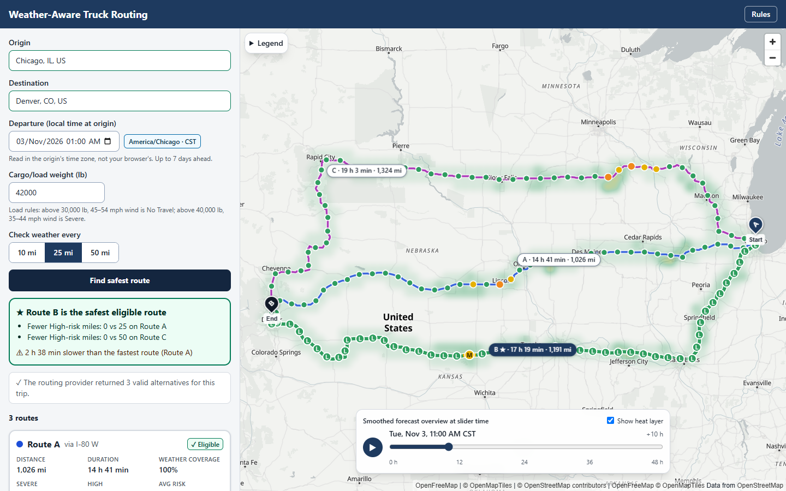
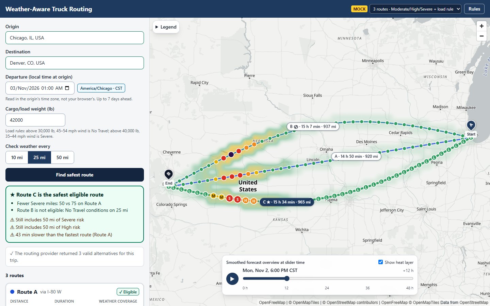
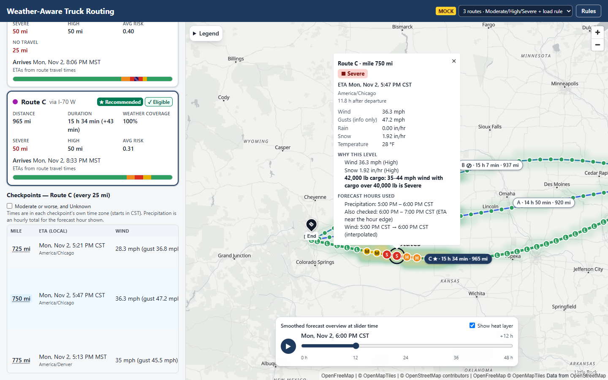
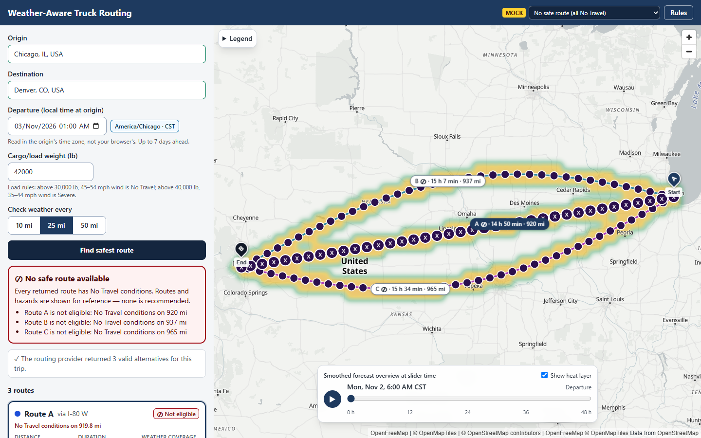
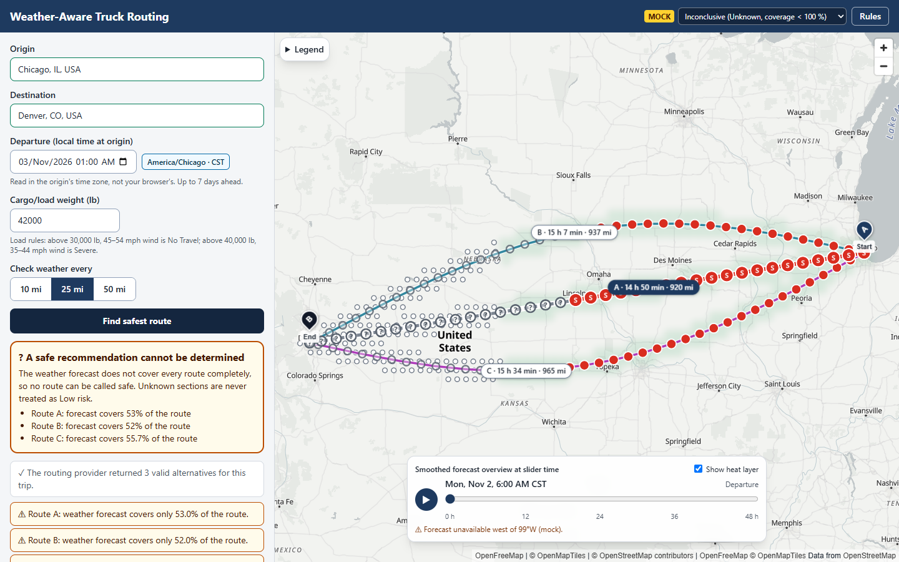
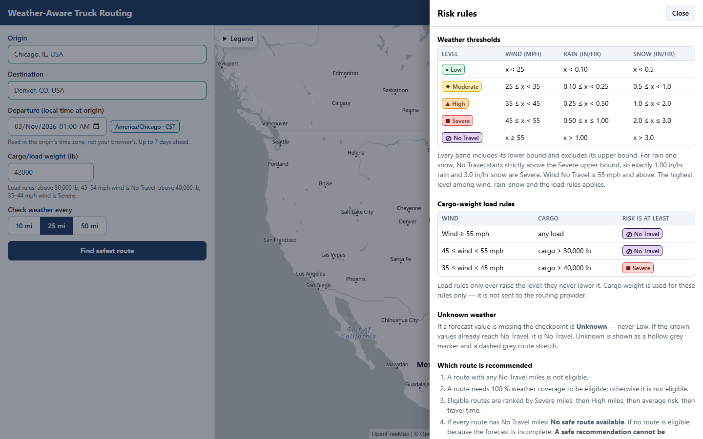
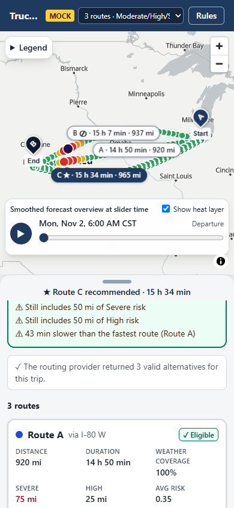

# Weather-Aware Truck Routing

[](https://github.com/gopiPatel16/Weather-Aware-Truck-Routing/actions/workflows/ci.yml)


A web app that helps a truck driver choose the **safest route** from **weather, cargo weight and travel time**. It asks a routing API for truck routes, forecasts the weather the truck will actually meet (at the time it will meet it), scores the risk with the assignment's thresholds and load rules, and recommends the safest *eligible* route, or says plainly when none is safe.

**Live demo:** https://weather-aware-truck-routing-l7mt.onrender.com
*(Free hosting: the first visit after ~15 minutes idle can take up to a minute to wake up — measured once at 14.5 s. The page shows a "server is starting up" message and retries by itself.)*
**API docs (Swagger):** https://weather-aware-truck-routing-l7mt.onrender.com/api/docs/



## Contents
[Features](#features) · [Screenshots](#screenshots) · [How it works](#how-it-works) · [Risk rules](#risk-rules-exactly-as-specified) · [Recommendation](#recommendation) · [Tech stack](#tech-stack) · [Project structure](#project-structure) · [Run locally](#run-locally) · [Configuration](#configuration) · [API](#api) · [Testing](#testing-and-quality) · [Deployment](#deployment) · [Performance](#performance) · [Assumptions and limitations](#assumptions-and-limitations) · [Documentation](#documentation) · [Attribution](#attribution)

## Features
- **Trip form:** origin and destination search (debounced, keyboard-friendly), departure date/time **read in the origin's time zone** (shown beside the field), cargo weight in pounds with the load-rule thresholds as helper text, and a 10 / 25 / 50-mile sampling interval.
- **Real truck routes:** TomTom truck routing, up to three routes. Only what the provider returns is shown, with an honest message such as "returned 2 valid alternatives". Nothing is invented.
- **Weather at the truck's ETA:** a checkpoint every N miles; each ETA comes from the route's own travel-time data; the forecast hour that *covers* that ETA is used (rain and snow are totals for the preceding hour, wind is interpolated), and the popup lists exactly which forecast hours were used.
- **Exact risk rules:** the wind / rain / snow thresholds and three cargo-weight load rules, with every boundary tested. Units are normalised to mph and in/hr.
- **Safe recommendation:** routes with any No Travel miles are never eligible; eligible routes are ranked by Severe miles → High miles → average risk → duration. All blocked → **"No safe route available"**. Incomplete forecast → **"A safe recommendation cannot be determined"**. Missing data is **Unknown**, never Low.
- **Map:** all routes, checkpoint markers coloured by level (with a letter and size as extra cues), risk-coloured stretches on the selected route, route chips, popups (ETA in the checkpoint's own time zone, values with units, "why", forecast hours used), start/end pins.
- **Heatmap + 0–48 h slider:** a smoothed overview below the map labels, all 49 hours preloaded so **scrubbing makes no network request**, play button (disabled when the system prefers reduced motion), Unknown cells drawn as hollow grey dots, and a legend that says markers and route colours are the exact categories.
- **Failure handling:** validation messages, loading steps, automatic retries (2 s / 5 s / 10 s) with a visible "server is starting up" notice and a manual Retry, provider-limit messages, heatmap failures that never block the routes, and a mobile (< 900 px) bottom-sheet layout.
- **Accessible:** labelled inputs, ARIA combobox, keyboard slider, `aria-live` results, visible focus, AA-contrast badges, and risk is never shown by colour alone. Lighthouse accessibility: 100.

## Screenshots
| | |
|---|---|
|  |  |
| **Storm demo scenario:** Route B has No Travel miles → not eligible; Route C is recommended | **Load rule:** 36 mph wind is only *High*, but 42,000 lb makes it *Severe*; the popup shows the forecast hours used |
|  |  |
| **No safe route:** every route is blocked, so nothing is recommended | **Cannot be determined:** incomplete forecast; Unknown is never treated as Low |
|  |  |
| **Rules drawer:** the exact tables the app uses | **Mobile:** results become a bottom sheet |

The demo scenarios use built-in mock data (see [Run locally](#run-locally)); the first screenshot uses live TomTom and Open-Meteo data.

## How it works
```
Browser (React + MapLibre)
   │  POST /api/plan · POST /api/heatmap · GET /api/geocode
   ▼
Django REST API ── planner: routes → checkpoints → ETA → forecast → risk → coverage/eligibility → ranking
   │                 │
   │                 ├─ TomTom Routing + Search (truck mode, alternatives, guidance offsets)
   │                 └─ Open-Meteo hourly forecast (batched, cached, unit-checked)
   └─ domain/  pure Python: geo, polyline, time zones, ETA, forecast-interval policy, risk, scoring, heatmap
```
1. **Routes:** TomTom `travelMode=truck` with up to two alternatives. Cargo weight is **never** sent (TomTom's `vehicleWeight` means the whole vehicle) and no vehicle specification is invented.
2. **Checkpoints:** positions every N miles along the route (always including the destination); each owns the stretch halfway to its neighbours, so miles per risk level add up exactly to the route length.
3. **ETA:** piecewise-linear through TomTom's per-instruction `(distance, travel time)` offsets. If offsets are missing the app falls back to uniform speed and **flags the ETAs as estimated**.
4. **Forecast interval:** the hour that covers the ETA; precipitation fields are sums over the *preceding* hour, wind is interpolated between the two surrounding hours, and within 15 minutes of an hour edge the neighbouring hour is also checked and the worse result kept.
5. **Risk and recommendation:** below.
6. **Heatmap:** a grid with 15-mile cells (real distance, not degrees) within 20 miles of any returned route, scored for all 49 hours with the same forecast policy and risk engine as the checkpoints, so overview and markers can never disagree on policy.

## Risk rules (exactly as specified)

| Level | Wind (mph) | Rain (in/hr) | Snow (in/hr) |
|---|---|---|---|
| Low | < 25 | < 0.10 | < 0.5 |
| Moderate | 25 ≤ x < 35 | 0.10 ≤ x < 0.25 | 0.5 ≤ x < 1.0 |
| High | 35 ≤ x < 45 | 0.25 ≤ x < 0.50 | 1.0 ≤ x < 2.0 |
| Severe | 45 ≤ x < 55 | 0.50 ≤ x ≤ 1.00 | 2.0 ≤ x ≤ 3.0 |
| No Travel | x ≥ 55 | x > 1.00 | x > 3.0 |

*Boundary convention:* Low is below the first threshold; each later band includes its lower bound and excludes its upper bound; No Travel for rain/snow starts strictly above the printed Severe upper bound (so exactly 1.00 in/hr and 3.0 in/hr are Severe). Every exact boundary and the values just above and below it are tested.

*Load rules (cargo weight, strictly greater than):* wind ≥ 55 → No Travel for any load · wind 45–54 and > 30,000 lb → No Travel · wind 35–44 and > 40,000 lb → Severe. The final level is the most severe of wind, rain, snow and the load rule — loads only ever raise it. **Missing weather is Unknown, never Low** (unless the known values already prove No Travel).

## Recommendation
- **Eligible** = no No Travel miles **and** complete weather coverage (every route mile has a known risk). Both are shown per route.
- **Ranked** (eligible routes only): fewest Severe miles → fewest High miles → lowest average risk (distance-weighted, Low 0 … Severe 3) → shortest travel time. The banner explains the first criterion that separated the winner ("Fewer Severe miles: 0 vs 25 on Route A") and what the winner still contains; it never claims a route is risk-free.
- **All routes blocked** → "No safe route available" (nothing is labelled Recommended). **No route eligible because the forecast is incomplete** → "A safe recommendation cannot be determined", with coverage per route.

## Tech stack
| Layer | Choice |
|---|---|
| Frontend | React 19, TypeScript 6, Vite 8, Tailwind CSS 4, plain `maplibre-gl` 6 behind a thin wrapper, Vitest + Testing Library, ESLint, Prettier |
| Backend | Python 3.12, Django 5.2 LTS, Django REST Framework, drf-spectacular (OpenAPI), httpx, tzfpy + zoneinfo, WhiteNoise, gunicorn |
| Data | TomTom Routing and Search; Open-Meteo hourly forecast; OpenFreeMap "Positron" basemap |
| Quality | pytest + respx, ruff, mypy, GitHub Actions |
| Hosting | One Docker container on Render (free tier) serving the API and the built React app |

Versions are pinned exactly; the compatibility notes are in [`frontend/README.md`](frontend/README.md).

## Project structure
```
backend/
  config/                 Django settings, URLs, WSGI
  trucking/
    api/                  views, serializers, error mapping, throttles
    domain/               pure Python (no I/O): geo, polyline, timezones, eta, forecast, risk,
                          checkpoints, scoring, heatmap, route_filters
    services/             routing/ (TomTom), geocoding/ (TomTom), weather/ (Open-Meteo, normalise, cache, mock)
    planner.py            routes → checkpoints → forecast → risk → eligibility → ranking
    tests/                unit/ and integration/ (276 tests)
frontend/
  src/                    api/ · components/ · map/ · state/ · utils/
  mock/                   fixture-backed fake API and demo scenarios
docs/                     PLAN, ACCEPTANCE, PERFORMANCE, WALKTHROUGH, spike report, API examples, screenshots
scripts/                  API spike scripts and example generator
Dockerfile · render.yaml · .github/workflows/ci.yml
```

## Run locally

**Backend** (needs a free TomTom key from [developer.tomtom.com](https://developer.tomtom.com), no credit card). Windows PowerShell:
```powershell
cd backend
python -m venv .venv
.\.venv\Scripts\python -m pip install -r requirements-dev.txt
copy .env.example .env        # then set TOMTOM_API_KEY in .env
.\.venv\Scripts\python manage.py runserver     # API on http://localhost:8000, docs at /api/docs/
.\.venv\Scripts\python -m pytest               # 276 tests
```
macOS / Linux: `python3 -m venv .venv && source .venv/bin/activate && pip install -r requirements-dev.txt && cp .env.example .env && python manage.py runserver`.

**Frontend** (Node 22.12+):
```powershell
cd frontend
npm ci
npm run dev          # http://localhost:5173, proxies /api to the backend
npm run dev:mock     # no backend: fixture scenarios with a picker in the header
npm run lint ; npm run typecheck ; npm test ; npm run build
```
`npm run dev:mock` offers demo scenarios (storm with a load-rule case, all-blocked, incomplete forecast, two routes only, cold start, errors). More detail: [`frontend/README.md`](frontend/README.md).

Notes:
- Without a TomTom key the API starts, but `/api/plan` answers "Routing is not configured". For a demo without real weather set `WEATHER_PROVIDER=mock` (synthetic storm, clearly labelled as demo data).
- If HTTPS calls fail with `CERTIFICATE_VERIFY_FAILED` (antivirus or a proxy re-signing traffic), set `USE_SYSTEM_CA_STORE=1` in `backend/.env`. Certificate checks stay on; the operating system's trust store is used.
- Keys are read from the environment only and are never logged.

## Configuration
Backend environment variables (`backend/.env`, see `backend/.env.example`):

| Variable | Purpose |
|---|---|
| `TOMTOM_API_KEY` | TomTom Routing + Search key (required for real routes) |
| `DJANGO_SECRET_KEY` | Django secret (generated automatically on Render) |
| `DJANGO_DEBUG` | `1` for local development |
| `DJANGO_ALLOWED_HOSTS` | Comma-separated hosts (e.g. `.onrender.com,localhost`) |
| `WEATHER_PROVIDER` | `open_meteo` (default) or `mock` (synthetic demo weather) |
| `WEATHER_MOCK_SCENARIO` | Scenario name when the mock provider is used |
| `OPEN_METEO_API_KEY` | Optional paid Open-Meteo plan key |
| `USE_SYSTEM_CA_STORE` | `1` to trust the OS certificate store (TLS-intercepting networks) |
| `LOG_LEVEL` | Logging level (request URLs containing keys are never logged) |

Frontend (build time): `VITE_MAP_STYLE_URL` (basemap style), `VITE_USE_MOCK`, `VITE_API_TARGET` (dev proxy). See [`frontend/README.md`](frontend/README.md).

## API
OpenAPI is served at `/api/docs/` (Swagger) and `/api/schema/`. Paths work with or without a trailing slash.

| Endpoint | Purpose |
|---|---|
| `POST /api/plan` | Routes, checkpoints, risk, eligibility and recommendation |
| `POST /api/heatmap` | Hourly risk levels (hours 0–48) for corridor cells |
| `GET /api/geocode?q=` | Place suggestions with their IANA time zone |
| `GET /api/health/` | Health check |

Example request to `/api/plan` (departure is a naive local time in the **origin's** zone):
```json
{
  "origin": { "label": "Chicago, IL", "lat": 41.8781, "lon": -87.6298 },
  "destination": { "label": "Denver, CO", "lat": 39.7392, "lon": -104.9903 },
  "departure_local": "2026-11-03T06:00",
  "cargo_weight_lb": 42000,
  "interval_miles": 25
}
```
The response contains `request` (resolved time zone and UTC departure), `alternatives` (requested / returned / usable and a message), `routes[]` (geometry, risk-coloured `segments`, `summary`, `eligibility`, `checkpoints[]` with ETA, weather and risk) and `recommendation` (`recommended | no_safe_route | inconclusive`). Errors use `{"error": {"code", "message", "retry_after_s?", "fields?"}}`. Full contract: [`docs/PLAN.md`](docs/PLAN.md) §7; real example payloads: [`docs/api-examples/`](docs/api-examples/).

## Testing and quality
- **Backend:** 276 tests (pytest + respx), 96 % coverage. Every exact risk threshold is tested at the boundary and just above and below it (`math.nextafter`), plus load rules (30,000 / 30,001 lb, 40,000 / 40,001 lb), ranking, units, ETA and forecast-interval selection, time zones including daylight-saving gaps and overlaps, provider failures (timeouts, rate limits, invalid or partial responses) and the API.
- **Frontend:** 80 tests (Vitest + Testing Library): formatting and time zones, risk colour mapping and contrast, form validation, heatmap decoding and weights, retry timing, combobox behaviour, recommendation banners, route cards, and "the slider makes no request".
- **CI:** [GitHub Actions](https://github.com/gopiPatel16/Weather-Aware-Truck-Routing/actions) runs ruff, mypy and pytest for the backend, and lint, typecheck, tests and the production build for the frontend.
- Evidence for every requirement: [`docs/ACCEPTANCE.md`](docs/ACCEPTANCE.md).

## Deployment
`Dockerfile` builds the React app and serves it, with the API, from one container (`gunicorn --workers 1 --threads 8`; one worker so the in-process cache is shared). `render.yaml` is a Render blueprint: create a Blueprint from the repository and set `TOMTOM_API_KEY` in the dashboard. Health check: `/api/health/`. Secrets live only in environment variables; `.env` is git-ignored.

## Performance
Measured on the live APIs (details and method: [`docs/PERFORMANCE.md`](docs/PERFORMANCE.md)):
- Plan: about 6–7 s cold (mostly TomTom's own 4–5 s for ~1000-mile trips), about 0.5 s when repeated within the cache window.
- Heatmap: 380–590 cells, 34–54 KB for all 49 hours.
- Frontend: 85 KB gzip initial JavaScript; the map library loads as a separate lazy chunk. One slider step costs about 0.2 ms on the main thread.
- Hosted Lighthouse (desktop): accessibility 100, best practices 100, performance 78 (the time is almost entirely evaluating the map library).

## Assumptions and limitations
- Cargo weight is used only for the load rules; it is **not** sent to the routing API. No axle, dimension or hazmat data is invented.
- ETAs assume continuous driving at the routing provider's truck speeds with typical traffic — no rest breaks or fuel stops. If the provider gives no timing data the ETAs are flagged "estimated from average speed".
- Only wind, rain and snow are modelled (no ice, fog or visibility). Wind means sustained 10 m speed; gusts are shown for information only.
- Forecast reliability drops with lead time, so departure is limited to 7 days ahead. The app uses US units (mph, in/hr, lb).
- The free Open-Meteo API is for **non-commercial** use (commercial use needs a paid plan) and allows about 600 locations per minute and 5,000 per hour per IP; every checkpoint and heatmap cell counts as one. The server waits out a per-minute limit (up to about a minute) and reports an hourly limit straight away; anything it cannot fetch becomes **Unknown** and the app says so. Repeat requests are cached for 30 minutes.
- TomTom answers take about 4–6 s for 1000-mile trips with alternatives, so a first plan takes roughly 6–10 s.
- The heatmap takes about 15–20 s to compute on the free hosting tier; routes appear first and stay usable meanwhile.

## Documentation
| Document | What it covers |
|---|---|
| [`docs/PLAN.md`](docs/PLAN.md) | Full specification, decisions and API contract |
| [`docs/ACCEPTANCE.md`](docs/ACCEPTANCE.md) | Every requirement with its evidence |
| [`docs/PERFORMANCE.md`](docs/PERFORMANCE.md) | Measured timings, heatmap size, Lighthouse, cold start |
| [`docs/spike/SPIKE_REPORT.md`](docs/spike/SPIKE_REPORT.md) | Live results from the TomTom and Open-Meteo tests |
| [`docs/WALKTHROUGH.md`](docs/WALKTHROUGH.md) | Walkthrough script |
| [`docs/api-examples/`](docs/api-examples/) | Example request and response payloads |
| [`frontend/README.md`](frontend/README.md) | Frontend setup, mock scenarios, pinned versions, accessibility |

## Attribution
Weather data by [Open-Meteo.com](https://open-meteo.com/) (CC BY 4.0) · Routing and search by [TomTom](https://www.tomtom.com/) · Map data © [OpenStreetMap](https://www.openstreetmap.org/copyright) contributors, OpenMapTiles, [OpenFreeMap](https://openfreemap.org).

## Author
Gopi Patel — [GitHub](https://github.com/gopiPatel16)
